# Pebrel Themes · 八种心情与流萤系列

Eight static themes by **XVSHIFU**: two color-only themes and six AI-generated landscape backgrounds.

[Download v1.0.0](https://github.com/XVSHIFU/pebrel-themes/releases/tag/v1.0.0) · [Checksums](SHA256SUMS.txt) · [Visual QA](QA-REPORT.json)

## 安装 / Install

从 Release 下载单独的 `.pebrel-theme.zip`，在 Pebrel 中导入并选择主题。也可使用 `pebrel theme import <file.pebrel-theme.zip>`；导入后在外观设置中应用。

Tested on Windows with Pebrel **2.2.2 (9db57b6)**. All eight packages passed native `theme check` and were individually loaded in isolated real app windows. Screenshots show dedicated demonstration output. macOS and Linux are untested. Window materials may vary with Windows settings; Mica/Acrylic do not imply background-image blur.

## Themes / 实机预览

### 宣纸 · rice-paper

暖白纸面、墨绿点缀。纯配色主题，无背景图。

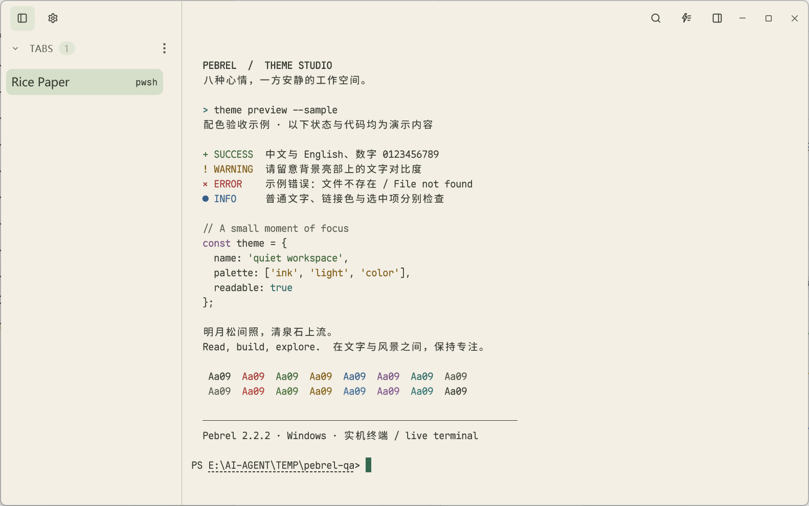

### 墨竹 · ink-bamboo

深墨绿底色与柔和青绿强调。纯配色主题，无背景图。

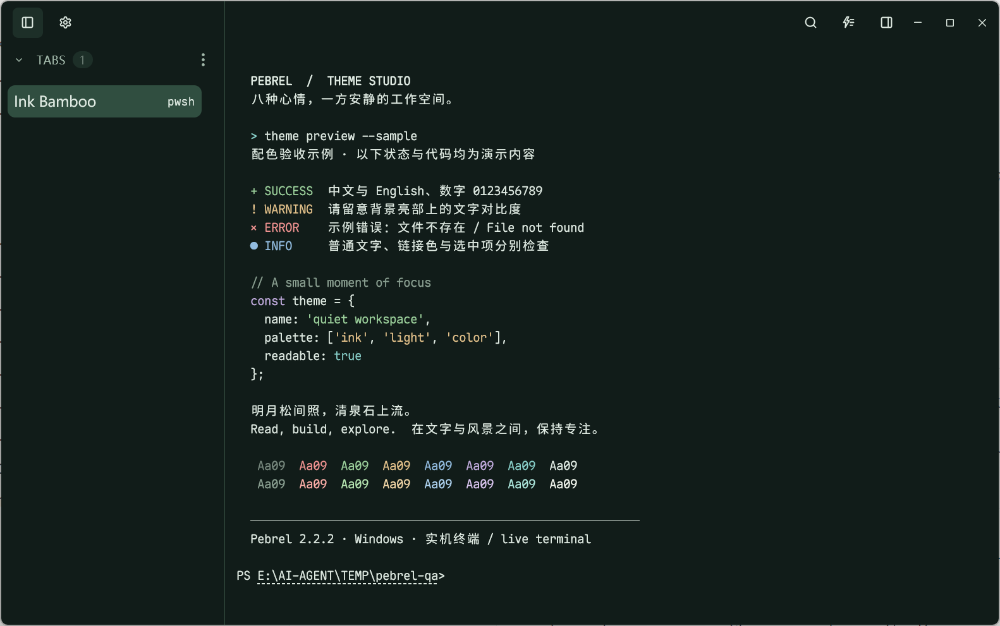

### 水彩幻境 · watercolor-reverie

淡玉色拱门、粉色树影与水彩雾气。

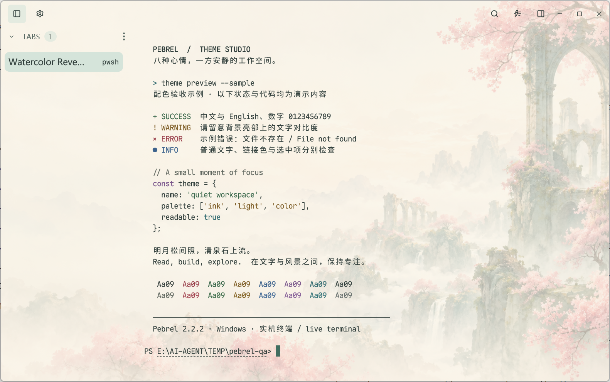

### 云上回廊 · pastel-arcades

桃色石阶与薄荷色回廊组成的空中建筑。

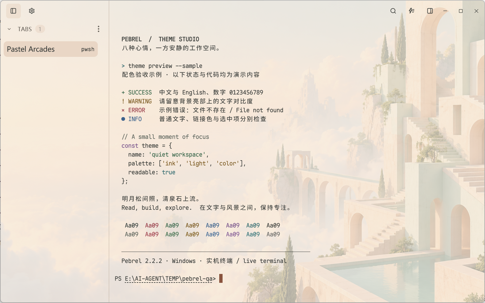

### 光庭 · concrete-sunlight

暖灰混凝土、斜向日光与庭院水景。

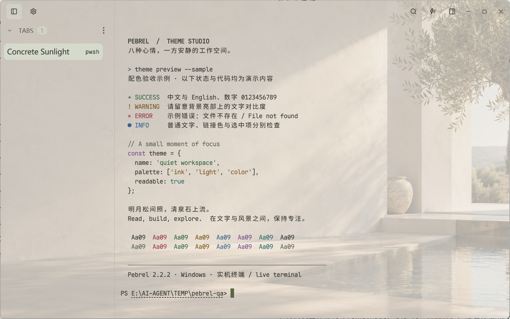

### 睡莲画室 · lily-atelier

浅紫与鼠尾草绿的睡莲池，保留油画笔触。

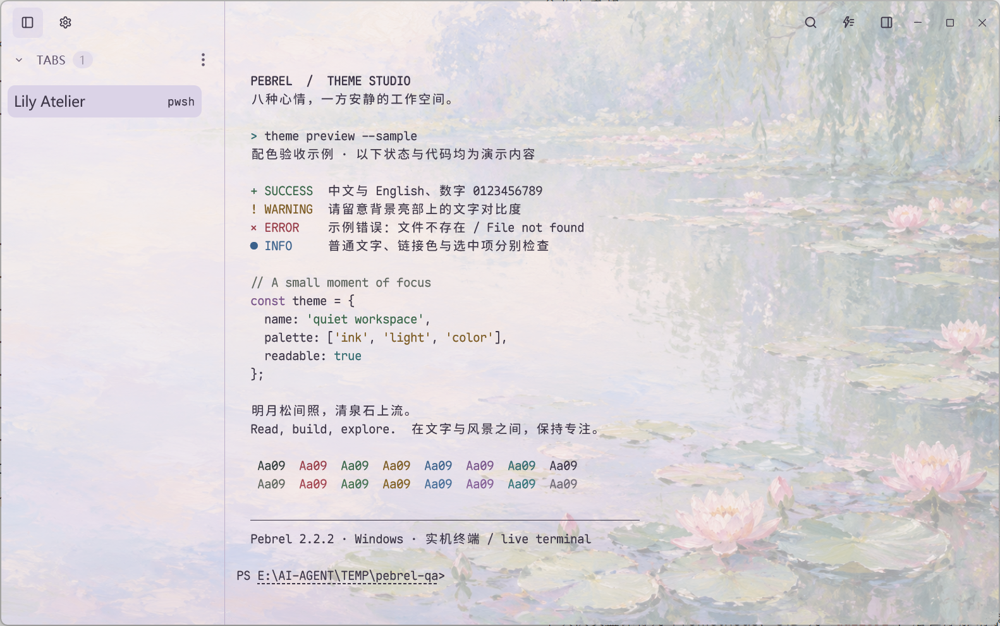

### 像素海港 · pixel-harbor

深蓝夜海、远山与琥珀灯光的像素风港湾。

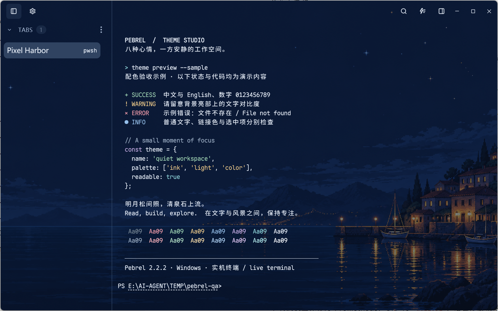

### 霓虹雨城 · rain-city-glass

克制的青蓝霓虹、雨夜高楼与水面倒影。

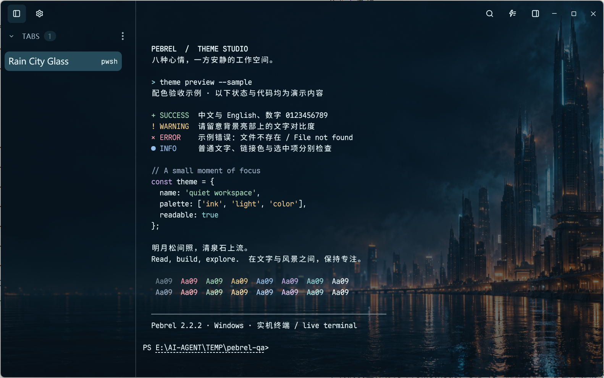

## License & provenance

Theme configuration: [MIT](LICENSE), copyright 2026 XVSHIFU. The six backgrounds were generated with OpenAI image_gen and are provided under [CC0-1.0](licenses/CC0-1.0.txt); [generation prompts](GENERATION.txt) are included. This CC0 dedication applies only to the original six landscape backgrounds, not the Firefly collection below. AI output is not claimed to be exclusive.

Screenshots include the Pebrel application UI, whose rights remain with its original rightsholders. These licenses cover our theme configuration and generated media, not third-party UI. Per-theme attribution is included beside each source.

## 流萤系列 · v1.1.0

新增四套已确认的主题：深浅剪影、浅色人物、暖奶油掌心微光。掌心微光采用横向扩图、45% 底色遮罩和更深正文，保留双手及两个人偶。以下均为 Pebrel 实机截图。

角色图片不属于 CC0 素材；配置与图片许可分开，详见 [来源与权利说明](licenses/FIREFLY-NOTICE.txt) 及各主题 ATTRIBUTION.txt。掌心微光的参考原图由用户提供，原作者与许可未知，背景经过 AI 扩图。

### 星穹铁道 | 流萤·银羽剪影

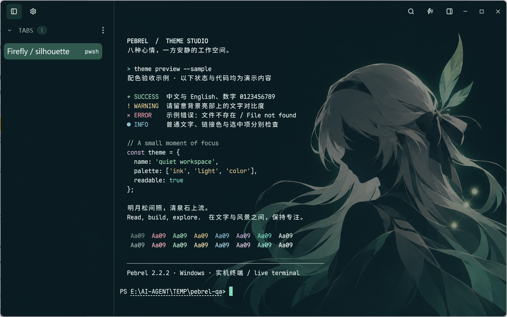

[下载主题](https://github.com/XVSHIFU/pebrel-themes/releases/download/v1.1.0/firefly-silhouette.pebrel-theme.zip)

### 星穹铁道 | 流萤·薄荷银羽

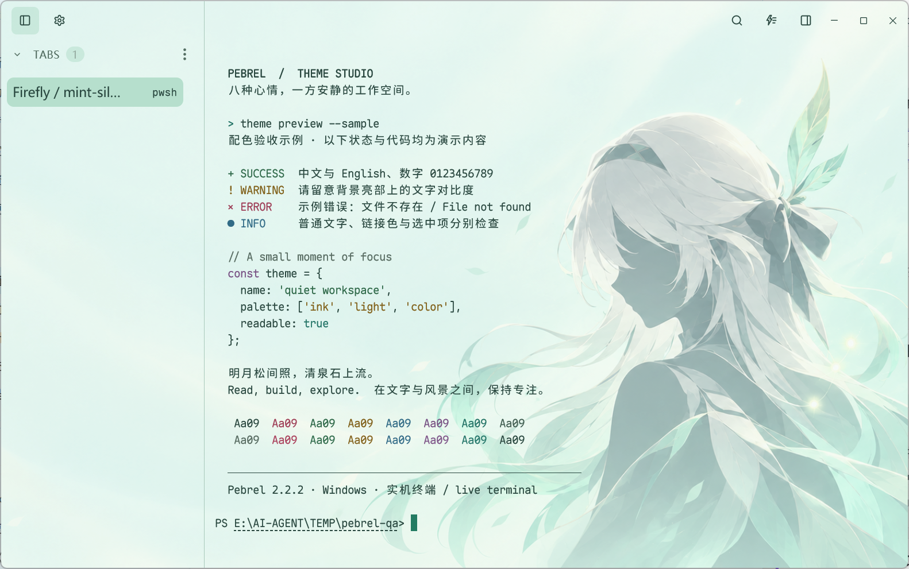

[下载主题](https://github.com/XVSHIFU/pebrel-themes/releases/download/v1.1.0/firefly-mint-silhouette.pebrel-theme.zip)

### 星穹铁道 | 流萤·浅青萤光

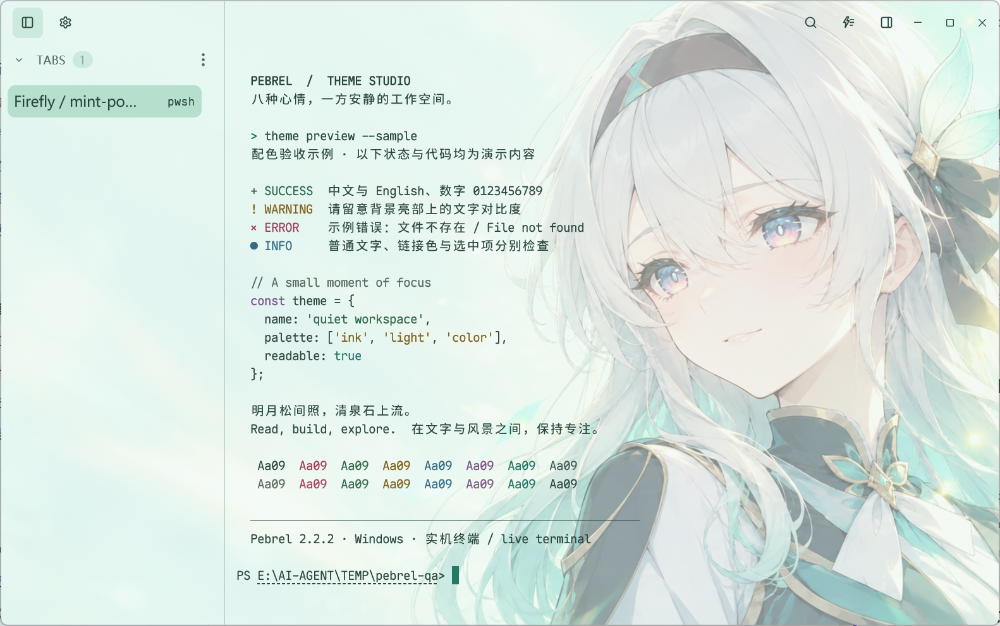

[下载主题](https://github.com/XVSHIFU/pebrel-themes/releases/download/v1.1.0/firefly-mint-portrait.pebrel-theme.zip)

### 星穹铁道 | 流萤·掌心微光

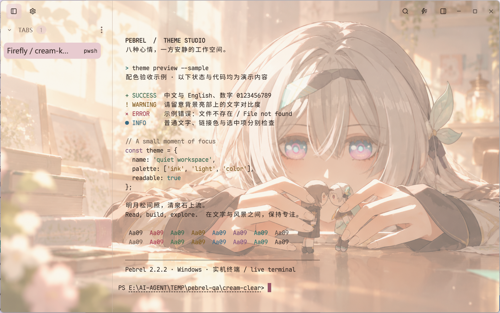

[下载主题](https://github.com/XVSHIFU/pebrel-themes/releases/download/v1.1.0/firefly-cream-keepsake.pebrel-theme.zip)
